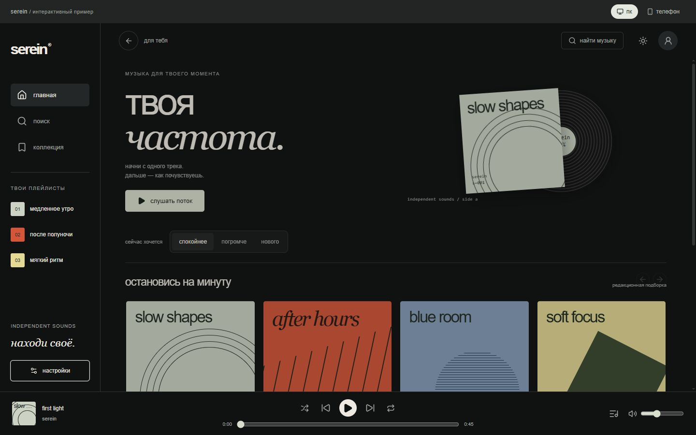
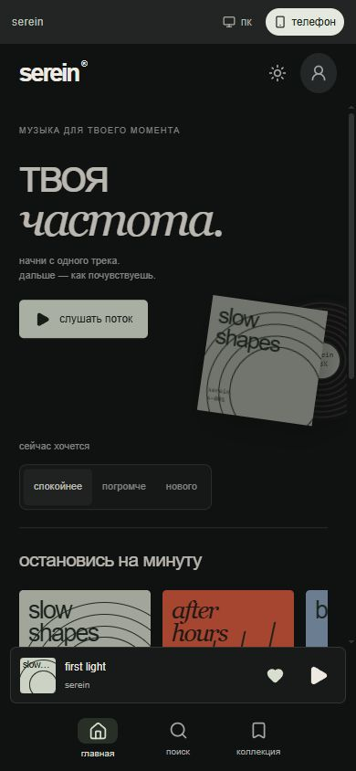

# serein / музыкальная площадка

два связанных интерактивных примера: **телефон** и **пк**. это дизайн-прототип музыкального продукта перед внедрением в основное приложение.

внутри: главная, поиск с результатами и пустым состоянием, коллекция треков/альбомов/артистов, страницы артиста и релиза, плейлисты, постоянный мини-плеер, полный плеер, очередь и настройки.

## посмотреть

- [телефон](https://w0rkl.github.io/serein-music-examples/?device=phone&v=7bb5b07#home)
- [пк](https://w0rkl.github.io/serein-music-examples/?device=desktop&v=7bb5b07#home)





`preview/standalone.html` — отдельный файл со встроенными стилями и кодом. его можно открыть двойным кликом без установки зависимостей. сверху есть переключатель «пк / телефон»; внутри — все страницы, плеер и анимации. фактический запуск этого экспорта в браузере пока не проверен.

готовая сборка находится в `preview/`. её можно разместить на любом статическом хостинге. две версии открываются параметрами:

- `index.html?device=phone#home`
- `index.html?device=desktop#home`

у них одинаковые разделы и каталог, но разная компоновка. на телефоне — нижняя пружинная навигация и компактный мини-плеер; на пк — боковое меню, больше информации в списках и плеер с громкостью внизу.

## запустить локально

из этой папки:

```sh
npm install
npm run dev
```

открыть адрес, напечатанный vite. готовую сборку можно смотреть без npm: запустить статический сервер для папки `preview/`, например `python -m http.server 5192 --directory preview`, и открыть `http://localhost:5192`.

## проверить и собрать

```sh
npm run typecheck
npm test
npm run build
```

`npm run build` создаёт `dist/`. в пакет добавлена копия этого результата в `preview/`. относительный `base` позволяет размещать пример в подпапке github pages.

`npm run export:preview` упаковывает текущую production-сборку в один `preview/standalone.html`.

## откуда взята структура

схема разделов изучена по официальным материалам яндекс музыки 13 октября 2026:

- [коллекция](https://yandex.ru/support/music/ru/collection/whatis)
- [поиск](https://yandex.ru/support/music/ru/new-library/search)
- [страница артиста](https://yandex.ru/support/music/ru/new-library/performers-page)
- [очередь](https://yandex.ru/support/music/ru/listening/playback-queue)
- [инструкция приложения android](https://inclusion.yandex.ru/tutorials/music-android)
- [инструкция сайта](https://inclusion.yandex.ru/tutorials/music-web)

live-сайт яндекс музыки был недоступен в регионе исследования. android-инструкция показывает версию 2025.03.4. поэтому это опора для навигации и сценариев, а не утверждение о точных нынешних пикселях интерфейса. визуальное оформление, название и каталог здесь свои.

## анимации

новые механики изучены на 21st.dev и сверены с открытым авторским исходником:

- [dock / ibelick](https://21st.dev/@ibelick/components/dock): увеличение навигации по расстоянию до указателя и пружинная ширина;
- [animated tabs / kuratlielia](https://21st.dev/@kuratlielia/components/tabs): общий индикатор выбранной вкладки;
- [morphing dialog / ibelick](https://21st.dev/@ibelick/components/morphing-dialog): presence-driven открытие и закрытие; общая обложка мини-плеера и полного плеера использует `layoutId`;
- [carousel / ibelick](https://21st.dev/@ibelick/components/carousel): полка с перемещением, перетаскиванием мышью и нативной прокруткой пальцем.

дополнительно: движение конверта и вращение пластинки при воспроизведении, реакция карточек на указатель и нажатие, переходы страниц и уведомления о сохранении. лицензии и точные границы адаптации — [THIRD_PARTY_NOTICES.md](THIRD_PARTY_NOTICES.md). полные исходные библиотеки не объявляются написанными нами.

анимации учитывают системный `prefers-reduced-motion`; в настройках есть дополнительный переключатель уменьшения движения. native buttons, checkbox/range semantics и нативный modal используются для доступных действий.

## ограничения

- релизы и артисты вымышлены; звук — синтезированный 45-секундный фрагмент для проверки плеера;
- нет настоящей авторизации, платежей, загрузки пользовательских файлов и музыкального backend;
- коллекция хранится локально в браузере и проверяется при чтении; лайк альбома не сохраняет все его треки;
- проверены typescript, production build и тесты модели. статический render-check проверяет наличие страниц; он не заменяет фактическую проверку в браузере;
- 13 октября 2026 живой сайт проверен в codex in-app browser на 1440×900 и 390×844: главная, поиск, коллекция, альбом, артист и плейлист. проверены запуск/пауза, переключение трека, полный плеер, очередь и её перестановка, закрытие через escape и пустой поиск. основной action виден; горизонтальной прокрутки страницы и ошибок консоли в пройденных сценариях не обнаружено;
- на телефоне исправлено пересечение декоративной обложки с заголовком. физический вывод звука и полный обход интерфейса клавиатурой не проверялись;
- указанный глобальный quality hook отсутствует на рабочем устройстве. зависимости установлены отдельно, install scripts не запускались.
- отдельная lint-конфигурация не задана. пробный запуск корневого oxlint применил правила основного next-приложения и вернул замечания next/react-compiler/accessibility; чистый lint не подтверждён.

пакет изолирован от основного приложения. github pages использует готовую сборку из `docs/`; исходники, автономный html и инструкции запуска находятся в этом репозитории.
